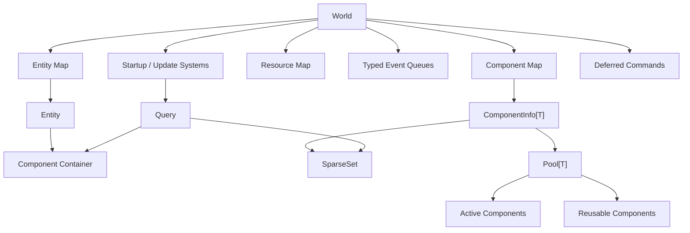

# go-ecs

`go-ecs` 是一个面向单线程游戏 World 的轻量 Go ECS。它使用 Sparse Set 维护组件成员关系、对象池复用组件，并提供系统、资源、延迟命令和按 Tick 双缓冲事件。

当前版本强调结构简单和运行时可预测，适合房间、战斗实例、模拟器等由单个 goroutine 持有状态的场景。它不是 Bevy 那种带并行调度器的完整游戏引擎 ECS。

## 环境

- Go 1.24
- 无第三方依赖

```powershell
go test ./...
go run .
```

## 功能

- Entity：单调递增的 `uint64` ID 和组件容器
- Component：按类型分配 ID，使用对象池创建和回收
- Sparse Set：O(1) 平均成员判断、添加和交换删除
- Query：多组件交集查询，自动选择最小组件集合开始扫描
- System：Startup 和 Update 两个执行阶段
- Commands：延迟销毁实体，以及 Resource 设置和移除
- Resource：World 级单例数据
- Events：类型安全、保持发送顺序的 Tick 双缓冲事件
- Lifecycle：组件和资源在替换、移除、实体销毁或 World 关闭时清理

## 架构



核心关系：

1. `SpawnComponent[T]` 从对应类型的 Pool 创建或复用组件。
2. `SpawnEmptyEntity` 建立 Entity → Component，以及 Component Type → Entity ID 两套索引。
3. Query 从参与查询的最小 Sparse Set 开始，只检查可能匹配的实体。
4. `World.Update()` 先推进事件批次，再按注册顺序执行 Update System。
5. `Commands.Execute()` 执行延迟销毁；调用方决定每个 Tick 的提交时机。
6. `World.Shutdown()` 销毁实体组件和资源，并清空事件及系统。

## 可运行示例

仓库的 [main.go](main.go) 展示了：

- Position、Velocity 组件
- 组件池的正确初始化方式
- MovementSystem 多组件查询
- GameTime Resource
- MovedEvent 写入和读取
- Tick 更新
- 移除组件
- 销毁实体

运行：

```powershell
go run .
```

输出：

```text
tick 1
tick 2
entity=1 position=(1.0, 0.5)
tick 3
entity=1 position=(2.0, 1.0)
moving entities after removing Velocity: 0
entities after destroy: 0
```

事件打印比移动晚一个 Tick，这是双缓冲事件的预期语义。

## Component

组件应使用指针类型，并嵌入 `ecs.Component`：

```go
type Position struct {
    ecs.Component
    X, Y float64
}
```

通过 Pool 创建：

```go
position := ecs.SpawnComponent[*Position](world)
position.X, position.Y = 10, 20
```

如果组件包含业务字段，应实现 `Init`，防止池复用时残留旧实体数据，同时保留框架设置的组件类型 ID：

```go
func (p *Position) Init() {
    *p = Position{Component: p.Component}
}
```

`Destroy()` 用于释放切片、句柄等外部资源。它会在组件被替换、移除、实体销毁或 World 关闭时调用。

## Entity

创建实体：

```go
entity := ecs.SpawnEmptyEntity(world, position, velocity)
```

添加、替换和移除组件：

```go
entity.AddComponents(health)
entity.RemoveComponents(&Velocity{})
```

读取组件优先使用泛型函数：

```go
position := ecs.GetComponent[*Position](entity)
if position == nil {
    // entity 没有 Position
}
```

自定义实体必须使用指针类型并嵌入 `*ecs.Entity`：

```go
type PlayerEntity struct {
    *ecs.Entity
    PlayerID string
}

player := ecs.SpawnEntity[*PlayerEntity](world, position)
player.PlayerID = "player-1"
```

## Query

`Query` 返回同时拥有全部指定组件的实体：

```go
entities := world.GetQuery().Query(&Position{}, &Velocity{})
for _, entity := range entities {
    position := ecs.GetComponent[*Position](entity)
    velocity := ecs.GetComponent[*Velocity](entity)
    _ = position
    _ = velocity
}
```

查询内部会选择实体数最少的组件集合开始遍历，因此参数顺序不影响扫描基数。Sparse Set 使用交换删除，不能依赖查询结果顺序。

其他查询方法：

| API | 作用 |
|---|---|
| `Has(entity, component)` | 判断实体是否拥有一个组件 |
| `Contains(entity, components...)` | 判断实体是否拥有全部组件 |
| `Get(entity, component)` | 非泛型方式读取组件 |

## System

系统实现 `ecs.ISystem`。通常嵌入 `*ecs.System`，并覆盖需要的生命周期方法：

```go
type MovementSystem struct {
    *ecs.System
}

func NewMovementSystem(world *ecs.World) *MovementSystem {
    return &MovementSystem{
        System: ecs.NewSystem(world, &Position{}, &Velocity{}),
    }
}

func (s *MovementSystem) Update() {
    s.RangeEntities(func(entity ecs.IEntity) {
        position := ecs.GetComponent[*Position](entity)
        velocity := ecs.GetComponent[*Velocity](entity)
        position.X += velocity.X
        position.Y += velocity.Y
    })
}
```

系统按添加顺序串行执行：

```go
world.AddStartUpSystem(loadSystem)
world.AddUpdateSystem(movementSystem)
world.Startup()
world.Update()
```

## Commands

销毁默认是延迟的：

```go
world.GetCommands().DestroyEntity(entity)

// 通常在所有 Update System 完成后统一执行。
world.GetCommands().Execute()
```

也可以链式立即执行：

```go
world.GetCommands().DestroyEntity(entity).Execute()
```

实体销毁会：

1. 从所有组件 Sparse Set 移除 Entity ID。
2. 调用组件 `Destroy()` 并将组件放回 Pool。
3. 清空实体组件容器，防止旧实体引用读到复用后的组件。
4. 从 World 删除实体。

## Resource

Resource 是按 Go 类型索引的 World 级单例：

```go
type GameTime struct {
    ecs.Component
    DeltaSeconds float64
}

world.GetCommands().SetResource(&GameTime{DeltaSeconds: 0.05})

resources := ecs.NewResources(world)
gameTime, ok := ecs.GetResource[*GameTime](resources)
```

生命周期约定：

- Resource 由调用方构造并初始化，`SetResource` 不调用 `Init()`。
- `SetResource` 同类型替换时销毁旧 Resource。
- `RemoveResource` 和 `World.Shutdown` 会调用 `Destroy()`。
- 设置后由 World 持有其生命周期，不应由业务代码重复销毁。

## Events

注册由 World 管理的事件：

```go
type DamageEvent struct {
    EntityID uint64
    Amount   int
}

damageEvents := ecs.RegisterEvents[DamageEvent](world)
reader := damageEvents.Reader()
writer := damageEvents.Writer()
```

发送和读取：

```go
writer.Send(DamageEvent{EntityID: entity.ID(), Amount: 10})

world.Update() // pending 批次变成 current 批次

for _, event := range reader.Get() {
    fmt.Println(event.EntityID, event.Amount)
}
```

事件语义：

- 一个 Tick 可以发送多个同类型事件，保持发送顺序。
- System 在当前 Tick 发送的事件从下一次 `Update()` 开始可见。
- 所有 Reader 看到同一个完整批次，读取不会消费事件。
- 当前批次会在再下一次 `Update()` 时过期。
- `Get()` 返回只读视图，仅在下一次 `Advance/Clear` 前有效。
- 独立使用 `NewEvents[T]()` 时，需要调用方手动执行 `Advance()` 和 `Clear()`。

## Sparse Set

Sparse Set 由：

- `density []T`：紧凑保存实际值
- `sparse [][]uint32`：从值映射到 density 索引
- `sparseMap map[uint64]uint32`：处理很大的值，避免创建巨大页表

Sparse 槽位使用 `densityIndex + 1` 编码：

- `0` 表示空槽
- `1` 表示 density 索引 0
- 最大可表达 density 索引为 `math.MaxUint32 - 1`
- SparseSet 的值 `0` 本身仍然有效

添加、判断和删除平均为 O(1)。删除会把 density 尾元素交换到被删除位置，因此遍历顺序不稳定。

## Tick 与线程模型

推荐主循环：

```go
for running {
    world.Update()
    world.GetCommands().Execute()
}
```

World、Entity、Pool、Query、Resource 和 Event 都按单 goroutine 所有权设计，不保证并发安全。网络、数据库等 goroutine 应把命令投递给 World 所在线程，再由该线程修改 ECS。

这种模型与当前 `world_server` 的 mailbox + Tick loop 一致，避免在核心容器内增加锁。

## API 一览

### World

| API | 作用 |
|---|---|
| `NewWorld()` | 创建 World |
| `AddStartUpSystem(system)` | 添加一次性启动系统 |
| `AddUpdateSystem(system)` | 添加 Tick 系统 |
| `Startup()` | 执行启动系统 |
| `Update()` | 推进事件并执行 Update System |
| `Shutdown()` | 清理实体、组件、资源、事件和系统 |
| `GetCommands()` | 获取命令入口 |
| `GetQuery()` | 获取查询入口 |

### Spawn

| API | 作用 |
|---|---|
| `SpawnComponent[T](world)` | 从组件 Pool 创建或复用组件 |
| `SpawnEmptyEntity(world, components...)` | 创建基础实体 |
| `SpawnEntity[T](world, components...)` | 创建嵌入 `*ecs.Entity` 的自定义实体 |

### Events

| API | 作用 |
|---|---|
| `RegisterEvents[T](world)` | 创建并注册自动推进的事件队列 |
| `NewEvents[T]()` | 创建手动推进的事件队列 |
| `Events.Reader()` | 获取 Reader |
| `Events.Writer()` | 获取 Writer |
| `EventReader.Has()` | 当前批次是否非空 |
| `EventReader.Get()` | 获取当前只读批次 |
| `EventWriter.Send(event)` | 写入 pending 批次 |

## 当前边界

- Entity ID 单调递增，不回收，因此当前不需要 generation；如果以后复用 ID，必须同时加入 generation 防止旧句柄指向新实体。
- 同一个组件实例不应挂到多个实体；当前 API 尚未保存组件所有者信息。
- Query 暂不支持 Without、Optional、Or、Added、Changed 等过滤器。
- Sparse Set 面向连续增长的 Entity ID；非常大的随机 ID 仍可能扩大外层页表。
- Pool 回收时查找 active component 是 O(n)，适合当前每个 World 实体较少的场景。
- 没有并行调度器、系统依赖图、快照序列化和关系组件。

## 后续演进

设计参考：

- [Bevy ECS 官方文档](https://docs.rs/bevy_ecs/latest/bevy_ecs/)
- [Bevy Query](https://docs.rs/bevy_ecs/latest/bevy_ecs/system/struct.Query.html)
- [Bevy Schedule](https://docs.rs/bevy_ecs/latest/bevy_ecs/schedule/struct.Schedule.html)
- [EnTT ECS 官方 Wiki](https://github.com/skypjack/entt/wiki/Entity-Component-System)

建议按实际需求依次增加：

1. 组件唯一所有者校验，阻止同一个池对象挂到多个实体。
2. 建立 Spawn、Query、Remove、Tick 的 benchmark，再增加 Query 的 Without 过滤和无分配 View/Range API。
3. 如果 Query 的 map 跳转成为瓶颈，让 ComponentInfo 的 Entity ID 与组件密集数组对齐，直接迭代组件数据。
4. Sparse Set 空洞页和组件 O(1) 回收索引，只在 benchmark 证明当前路径不足时实现。
5. Added、Changed、Removed 变更检测，用于减少无效系统扫描。
6. Entity-targeted Event 或 Observer，用于局部响应；保留当前批量 Event 处理高频事件。
7. 明确的 System 阶段和 before/after 顺序；只有系统数量和冲突明显增加后才考虑依赖图。
8. Entity ID 回收 + generation，仅在长期 World 的 ID 增长或批量创建成为问题时引入。
9. 快照协议只提供遍历接口，具体编码交给业务层。
10. Archetype、Group 和并行调度器属于大规模性能路线，必须有 benchmark 证明 Sparse Set 模型不够再开发。

## 目录

```text
go-ecs/
├── array/              # Pool 使用的轻量数组
├── ecs/
│   ├── commands.go     # 延迟命令和 Resource 写操作
│   ├── component.go    # Component、ComponentInfo
│   ├── entity.go       # Entity 和组件容器
│   ├── events.go       # Tick 双缓冲事件
│   ├── pool.go         # 组件对象池
│   ├── query.go        # 多组件查询
│   ├── resources.go    # Resource 读操作
│   ├── spawner.go      # Entity、Component 创建
│   ├── system.go       # System 基础类型
│   └── world.go        # World 和生命周期
├── sparse_set/         # Sparse Set
├── main.go             # 完整可运行示例
└── README.md
```

## License

MIT
